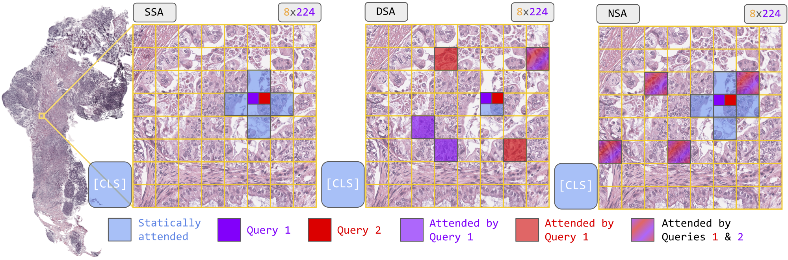

# Sparse Attention for Extreme-Resolution Scaling in Digital Histopathology

[](https://opensource.org/licenses/MIT)
[](https://www.python.org/downloads/release/python-3120/)
[](https://github.com/astral-sh/uv)
[](https://github.com/astral-sh/ruff)

This repository contains the code for our paper **"Sparse Attention for Resolution Scaling in Digital Histopathology"**,
which investigates sparse attention mechanisms (SSA, DSA, NSA) as an alternative to dense self-attention for gigapixel
Whole Slide Image (WSI) classification. We show that sparse attention enables resolution scaling beyond what dense
attention can handle, and introduce **Mondriaan**: a synthetic benchmark that exposes the limitations of pooling-based
MIL methods.



---

## Repository structure

```
sparse-wsi-vit/
├── src/sparse_wsi_vit/
│   ├── configs/          # Python experiment configs (one per model/dataset)
│   ├── datasets/         # Dataset classes for CAMELYON16, Mondriaan
│   ├── experiments/      # Datamodules, Lightning wrappers, trainer, utilities
│   └── models/           # ABMIL, TransMIL, ViT-5 (Dense, SSA, DSA) + Triton kernels
├── experiments/
│   └── run.py            # Main training entry point
├── scripts/
│   └── example_job.sh    # Example SLURM job script for Snellius (SURF)
├── tests/                # Unit and integration tests
├── pyproject.toml
└── uv.lock
```

---

## Requirements

- Python 3.12
- [`uv`](https://docs.astral.sh/uv/getting-started/installation/) (replaces pip/venv)
- A CUDA-capable GPU (H100 or A100 recommended for EMB-scale experiments; RTX 5090 also used)
- The preprocessed CAMELYON16 dataset (see [Data](#data) below)

Install `uv` if you don't have it:

```bash
curl -LsSf https://astral.sh/uv/install.sh | sh
```

All other dependencies are managed by `uv` via `pyproject.toml` and the lockfile — no manual `pip install` needed.

---

## Installation

```bash
git clone https://github.com/p-adema/sparse-wsi-vit.git
cd sparse-wsi-vit
uv sync          # installs all dependencies into an isolated .venv
```

---

## Data

### CAMELYON16

We provide our **preprocessed** version of CAMELYON16 (Virchow2 CLS + patch embeddings at multiple scales,
background-filtered with GrandQC) as a public storage
bucket: [camelyon16_embeddings](https://huggingface.co/buckets/62f4c677-0da5-4459-8852-f579e74ad0c7/CAMELYON16_embeddings).
Download it and place the `camelyon-emb/` directory alongside the repo, and similarly for the train/val/test CSV splits:

```
parent/
├── sparse-wsi-vit/     ← this repo
├── camelyon-emb/       ← preprocessed H5 embeddings
│   ├── <slide_id>.h5
│   └── ...
└── splits/
    └── camelyon/
        └── full/
            ├── train.csv
            ├── val.csv
            └── test.csv
```

Each `.h5` file contains per-slide embeddings at all scales used in the paper (`cls_224x224`, `patches_224x224`,
`patches_112x112`, `patches_56x56`, etc.) along with matching coordinate arrays (`coords_224x224`, `coords_112x112`,
`coords_56x56`).

> **Note:** the raw CAMELYON16 WSIs are available
> at [camelyon16.grand-challenge.org](https://camelyon16.grand-challenge.org/). Re-preprocessing from scratch requires
> GrandQC and Virchow2, see Appendix B of the paper for full details.

### Mondriaan (synthetic)

Mondriaan is a synthetic pixel-level benchmark designed to expose the limitations of pooling-based MIL methods. Four
4×4-pixel objects are placed at random positions in a 32×32 black image. The label is 1 when exactly one matching pair
exists among the four objects, and 0 when all four are distinct. Each object independently samples 4 random RGB colors,
making the matching pair pixel-identical but leaving no discriminative mean-color signal for pooling-based aggregators (
ABMIL). A solid-color control variant is included where mean color IS discriminative, confirming that failure on the
patterned task is arrangement-specific.

Data must be pre-extracted to HDF5 using `extract_mondriaan.py` before training. The dataset split is fixed at 10 000
train / 2 000 val / 2 000 test with a balanced label distribution.

```bash
uv run src/sparse_wsi_vit/datasets/mondriaan_dataset/extract_mondriaan.py \
    --output_dir data/mondriaan/patterned_ps1 --image_size 32 --random_colors

# resolution ablation (2× pooled)
uv run src/sparse_wsi_vit/datasets/mondriaan_dataset/extract_mondriaan.py \
    --output_dir data/mondriaan/patterned_ps2 --image_size 32 --pool_size 2 --random_colors
```

---

## Running experiments

All experiments are launched through `experiments/run.py`, driven by a config file.

### Basic usage

```bash
uv run experiments/run.py --config src/sparse_wsi_vit/configs/<config_name>.py
```

For example, to reproduce the Dense ViT-5 baseline at 224 × 224 px (CLS tokens):

```bash
uv run experiments/run.py --config src/sparse_wsi_vit/configs/baseline_vit5dense_preembed.py \
    dataset.features_name=cls_224x224
```

Available configs (one per row in Table 1 / Appendix F of the paper):

| Config file                      | Model       | Feature | Patch size |
|----------------------------------|-------------|---------|------------|
| `baseline_abmil_camelyon.py`     | ABMIL       | CLS     | 224 px     |
| `baseline_abmil_camelyon.py`     | ABMIL       | EMB     | 224 px     |
| `baseline_transmil_camelyon.py`  | TransMIL    | CLS     | 224 px     |
| `baseline_transmil_camelyon.py`  | TransMIL    | EMB     | 224 px     |
| `baseline_vit5dense_preembed.py` | Dense ViT-5 | EMB     | 224 px     |
| `ssa_*.py`                       | SSA ViT-5   | EMB/CLS | 56–448 px  |
| `dsa_*.py`                       | DSA ViT-5   | CLS/EMB | 112–224 px |
| `nsa_*.py`                       | NSA ViT-5   | EMB/CLS | 112–224 px |
| `mondriaan_*.py`                 | all models  | —       | synthetic  |

You can override any config key on the command line using the dot-notation:

```bash
uv run experiments/run.py \
    --config src/sparse_wsi_vit/configs/baseline_vit5dense_preembed.py \
    training.seed=1 \
    training.max_epochs=30
```

### Running tests

```bash
uv run pytest
```

---

## Running on Snellius (SURF HPC)

The `scripts/example_job.sh` script is an example SLURM batch job. Submit it with:

```bash
sbatch scripts/example_job.sh
```

---

## Results summary

Performance on CAMELYON16 test set (224 × 224 px, Virchow2 embeddings):

| Model       | CLS Acc  | CLS F1   | EMB Acc  | EMB F1   | s/epoch |
|-------------|----------|----------|----------|----------|---------|
| ABMIL       | .938     | .918     | .907     | .860     | 91      |
| TransMIL    | .721     | .721     | .868     | .847     | 102     |
| Dense ViT-5 | .922     | .891     | **.938** | **.911** | 189     |
| SSA ViT-5   | **.938** | **.915** | .868     | .790     | 130     |
| DSA ViT-5   | .876     | .830     | .620     | .000     | 797     |
| NSA ViT-5   | .922     | .891     | .868     | .821     | **100** |

SSA is the only model that continues to improve as patch size decreases down to 56 × 56 px (millions of visual tokens),
where dense attention runs out of memory.

---

## Contribution and code quality

If you have ideas or contributions you wish to add to the code base,
feel free to send a PR! However, make sure to run a Black-style
formatter (e.g. Ruff) first.

## Citation

If you use or build upon this code, please cite our work.
